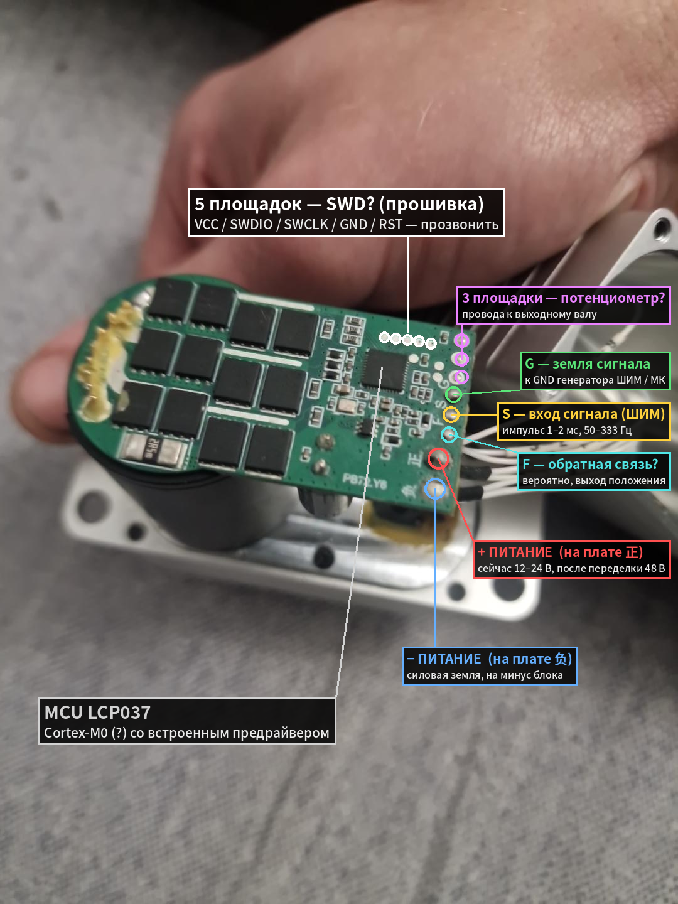
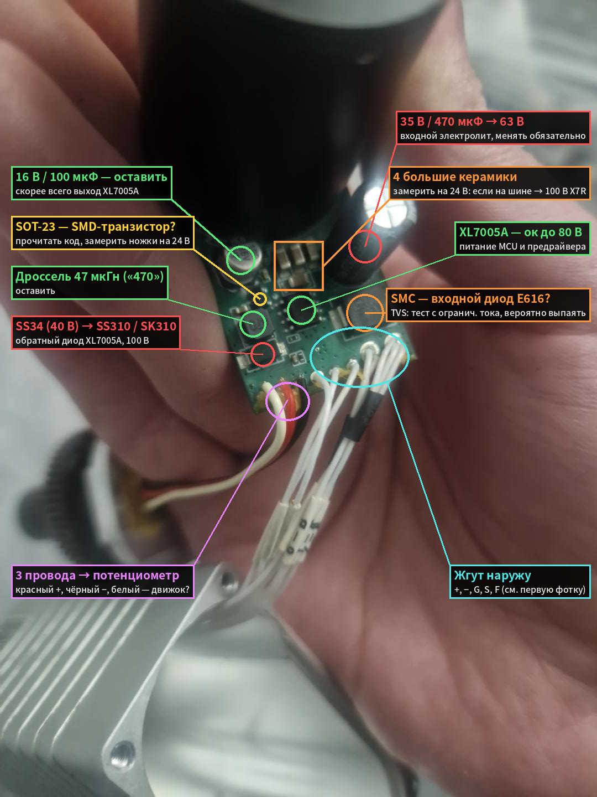
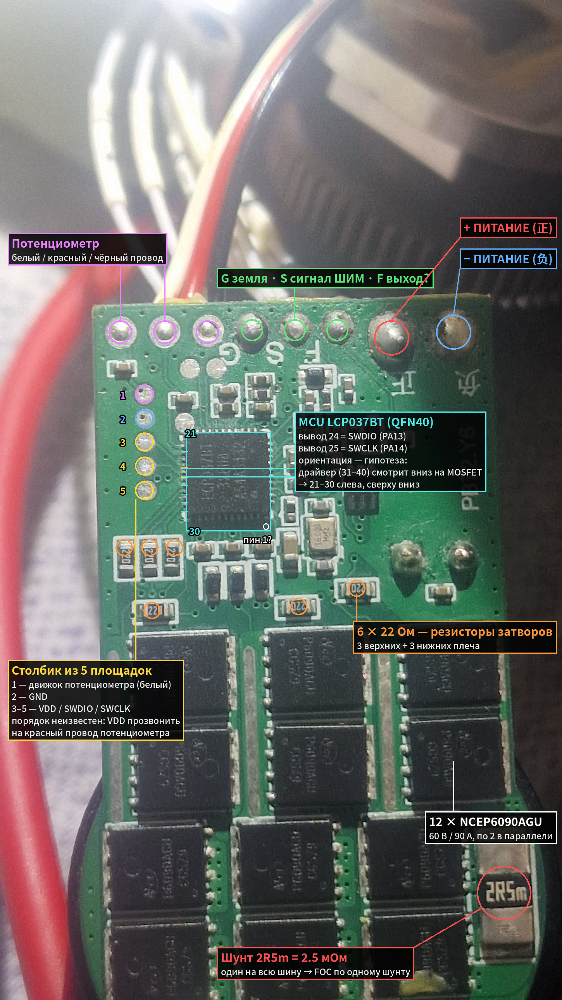

# Реверс-инжиниринг сервопривода CS200 (Kpower HB200T) со сбитых «Шахедов» и «Гераней»

Своя прошивка в родной микроконтроллер на родной плате: от дампа Flash через SWD до клона 1 в 1 и дальше —
момент в амперах, импеданс одной командой, синусоидальная коммутация, самотест, чёрный ящик. Ни одного своего
резистора на плате не добавлено.

*Reverse engineering of the Kpower HB200T brushless servo salvaged from downed Shahed/Geran drones: SWD dump of the
stock firmware, a bit-exact GCC clone of it running on the original Linsynix LCM32F037 (Cortex-M0, 32 KB flash, 4 KB RAM),
then a new control stack on top — model-based current limiting, MIT-style impedance commands with time-stamped cubic
interpolation, sinusoidal commutation with Hall interpolation, self-identification, flight recorder. All in Russian.*

## Что это за серва
- 200 кг·см стопового момента, 12–24 В, 15 А, бесколлекторный инраннер Ø29×42 мм с Холлами и 4-ступенчатым стальным
  редуктором ≈ 1:220, алюминиевый корпус. На БПЛА стояла как рулевая машинка с управлением ШИМ 50–333 Гц.
- Плата: MCU **Linsynix LCP037BT32EU8** (ядро LCM32F037, Cortex-M0 72 МГц, 32 КБ Flash, 4 КБ SRAM, **встроенный
  трёхфазный предрайвер**), 12 × NCEP6090AGU (60 В / 90 А) по два на плечо, один шунт 2.5 мОм в шине, buck XL7005A.
- Родная прошивка: Dynamixel Protocol 1.0 (таблица AX-12 плюс поля Kpower) по полудуплексному UART на сигнальном проводе,
  загрузчик с обновлением по тому же проводу, журнал настроек во Flash.

## Как это выглядело в первый день
Подписи на фото — гипотезы до прозвонки и реверса (со знаками вопроса); проверенная распиновка — в [docs/pinmap.md](docs/pinmap.md).

| Плата со стороны MCU | Обратная сторона: питание логики |
|---|---|
|  |  |

## Что сделано
| Этап | Результат |
|---|---|
| **Вскрытие** | SWD-гребёнка найдена и прозвонена, Flash не защищён (RDP 0) — дамп прошивки, загрузчика и инфо-зоны чипа ([docs/memory_map.md](docs/memory_map.md)) |
| **Реверс** | Ghidra по SVD из Keil-пака: тактирование, маршрутизация TIM1 → предрайвер, Холлы, АЦП потенциометра/тока/шины, протокол, журнал, контур положения — [docs/native_fw_config.md](docs/native_fw_config.md), [docs/pinmap.md](docs/pinmap.md) |
| **Клон** | `fw/` — функциональный клон родного приложения под GCC/CMake, живёт под родным загрузчиком. A/B на одной серве: ступеньки совпали в пределах выборки 20 мс и шума потенциометра ([docs/clone_ab_test.md](docs/clone_ab_test.md)) |
| **Своя прошивка v1.5** | всё ниже; справочник — [docs/registers_v1.md](docs/registers_v1.md), стенды — [docs/bench_log.md](docs/bench_log.md) |
| **Мотор** | pp = 1, Kv ≈ 1475 об/мин/В, R = 505 мОм, трение, мёртвый ход редуктора ~12° при реверсе — [docs/motor.md](docs/motor.md) |

### Что умеет прошивка v1.5 (Flash 21.8 из 26.5 КБ, RAM 2.6 КБ, без soft-float)
- **Момент в амперах.** Потолок duty по модели (I·R + Ke·ω)/Vbus каждую мс — без запаздывания фильтра шунта. Ступенька 50° на
  полном duty: 0.12 с, перерегулирование 2–5 ед из 4096, ток шины ≤ 3.5 А вместо 15 А и ухода ЛБП в защиту.
- **Импеданс одной записью** (как MIT Mini Cheetah / moteus): p, v, Kp, Kd, τ_ff, tmax, время исполнения. Синхронизация часов
  по шине и кубическая интерполяция цели по меткам времени: хост шлёт 50–100 Гц, серва ведёт цель гладко на 1 кГц, новые
  точки склеиваются на ходу без рывка.
- **Синусоидальная коммутация** с интерполяцией угла по Холлам и 3-й гармоникой, обновление в прерывании TIM1 на 23.4 кГц
  без делений (~150 тактов из 3077). Подбор сдвига расстановки Холлов и опережения по асимметрии тока.
- **Холлы как датчик**: скорость по 6 фронтам (шум 150 → 10 шаг/с), счётчик, одометр.
- **Защиты как фичи, а не как стоп-кран**: мягкие упоры с пружиной, детект упора и контакта (ротор затормозил, а контур
  толкал — 2–3 мс, без IMU), политика отказа (тормоз / свободный ход / удержание в точке при потере связи), автомат
  состояний и защёлка, I²t с «процентом доступного момента», TEST_UNLIMITED на 10 с с записью предыстории.
- **Самотест одной командой**: порядок Холлов, направление, шагов на единицу датчика, Kv, трение (Кулон + вязкое),
  duty страгивания, мёртвый ход при реверсе; возврат в точку старта.
- **Паспорт и телеметрия**: UID чипа и назначение ID по UID без доступа к серве, температура кристалла по заводской
  калибровке, энергия из шины, счётчики пакетов, момент на выходе в мН·м с вычетом трения, чёрный ящик 260 мс по 5 мс
  с заморозкой по событию, быстрая телеметрия одним SYNC_READ, сохраняемая конфигурация в своём секторе Flash.
- Совместимость со стоком сохранена: Dynamixel 1.0, тот же журнал, родной загрузчик на месте, откат одной командой.

## Как это делалось

**1. Вскрытие.** На руках — ящик сервоприводов со сбитых дронов, из документации только паспорт на сайте Kpower. Внутри плата
с незнакомым китайским чипом Linsynix LCP037BT32EU8: Cortex-M0 и трёхфазный предрайвер в одном корпусе QFN40, 12 ключей по два
на плечо, один шунт 2.5 мОм в минусовой шине, потенциометр на боковой шестерне. Прозвонка: столбик из пяти площадок слева от MCU —
VDD, GND, SWDIO, SWCLK, nRST. Серва питается от лабораторного БП с лимитом 100 мА, ST-Link + pyOCD, `cortex_m` вслепую: CPUID
0x410CC200, защита Flash на уровне 0. Дамп Flash, загрузчика и инфо-зоны, sha256, одна серва отложена нетронутой.

**2. Документы.** Даташиты чипа на LCSC, Keil-пак с SVD и алгоритмом Flash, потом Reference Manual с сайта Linsynix — на китайском;
текст вытаскивается PyMuPDF (`tools/rm_pages.py`), дальше grep по иероглифам. Без RM многое пришлось снимать экспериментом
(см. п. 7).

**3. Реверс.** Ghidra, Cortex-M0 Thumb, карта периферии из SVD скриптом (`re/ghidra_scripts`). По регистрам нашлись: кварц 16 МГц →
PLL 72 МГц; TIM1 с комплементарными каналами на внутренние входы предрайвера; Холлы на PA4–PA6 через EXTI; потенциометр, ток через
внешний усилитель и делитель шины на АЦП через DMA; UART1 на сигнальном проводе с DMA и переключением направления. Протокол оказался
Dynamixel 1.0 с таблицей AX-12 и полями Kpower, цель в микросекундах 900..2100, журнал настроек записями по 128 байт в последних
двух секторах, загрузчик Kpower в первых 4 КБ с форвардингом прерываний в приложение ([docs/native_fw_config.md](docs/native_fw_config.md),
[docs/pinmap.md](docs/pinmap.md)).

**4. Клон.** GCC + CMake, своя таблица векторов, линковка с 0x08001000 — родной загрузчик остаётся и умеет обновлять по проводу.
Функции переносились по адресам 1 в 1, вплоть до двойного вызова инициализации тактирования и неинициализированных полей структур.
Первая прошивка — только проверка периферии скриптом, который читает регистры по символам ELF через SWD; потом мотор при лимите
тока; потом A/B против родной прошивки на той же серве: траектории совпали в пределах выборки ([docs/clone_ab_test.md](docs/clone_ab_test.md)).

**5. Стенд через SWD, а не через шину.** USB-UART адаптер для полудуплекса так и не был доведён (джампер питания, пайка, резистор в TX),
и весь стенд переехал на SWD: скрипты пишут регистры прямо в RAM по символам ELF, читают телеметрию 50 раз в секунду, а чтобы
таймаут шины не снимал момент — шлют «сердцебиение». Попутно выяснилось, что ST-Link ругается на верификацию записи, когда прошивка
перезаписывает байт быстрее него, и что зависший pyOCD роняет пробник из USB до переподключения.

**6. Своя прошивка поверх клона.** Холлы как датчик (счётчик, период, скорость), телеметрия, защиты, контроллер с трапецией и PD,
оценка сопротивления и температуры обмотки онлайн, IWDG с защитой от цикла перезагрузок, SYNC_READ со слотами.

**7. Что дал Reference Manual.** АЦП синхронно с ШИМ от TIM1_OC4 — заработало только с установленным CC4E, хотя на вывод канал не
выходит. Сторож АЦП → OCREF_CLR как аппаратный лимит тока: перебор четырёх комбинаций окна и уровня, одна из них — разнос, другая —
глухой стоп, рабочая — окно 0..HT с активным низким уровнем. Компаратор на входе тока не переключается ни при каком пороге — так и
остался открытым вопросом. Главное открытие: сигнал шунта на плате отфильтрован, синхронная выборка даёт средний ток шины, а не ток
в окне ключа — это определило всю дальнейшую архитектуру момента.

**8. Импеданс и момент в амперах.** Команда p, v, Kp, Kd, τ_ff одной записью. Первые тесты «прошли» подозрительно спокойно: стоковый
Torque Limit = 300 из журнала резал выход. Сняли — и ступенька на полном duty с места уронила ЛБП в защиту: 24 В / 0.5 Ом ≈ 48 А по
Ому, а при реверсе на ходу ещё больше. Измеренный ток ограничить не успевает (фильтр), сторож АЦП тоже. Решение — потолок duty по
модели (I·R + Ke·ω)/Vbus каждую миллисекунду: ток физически не может превысить лимит, измерение только страховка. Та же ступенька
под 8 А стала быстрее и точнее, чем без потолка. По дороге: оценка скорости по Холлам держала старое значение до 100 мс после
остановки и раскачивала привод на 16 А; два регистра перекрывались байтом; измеренный ограничитель замораживал потолок навсегда.

**9. Место под фичи.** Библиотека soft-float занимала 9.5 КБ — сток считал Present Load через double. Всё переведено в целые
(Q8-профили, микроджоули, точные дроби стока) — Flash 25 → 16 КБ. На освободившееся место: интерполяция по меткам времени, мягкие упоры,
детект упора и контакта, политика отказа, автомат состояний, паспорт по UID, температура кристалла (калибровка в инфо-зоне чипа),
счётчики, чёрный ящик, сохраняемая конфигурация, самотест, синусоидальная коммутация.

**10. Ревью до стенда.** Пять пакетов написаны вслепую (пробник был недоступен), поэтому перед прошивкой — два независимых прохода
ревью: 20 с лишним находок, среди них сдвиг кольца АЦП при остановке посреди последовательности каналов, обход защёлки командой,
рваная запись команды по шине, перекрытие регистров, переполнение тепла. Всё исправлено до первого запуска.

**11. Стенд без редуктора.** 14 из 14 проверок. Синус поехал с первого раза: 97 % скорости шестишаговой при том же duty; по
асимметрии тока в двух направлениях найден сдвиг расстановки Холлов (+6° эл.) и опережение (+8°). Скорость по 6 фронтам убрала
шум неравномерной расстановки Холлов (150 → 10 шаг/с). Сопротивление — по заблокированному валу: 505 мОм (на duty 120 вал уже не
удержать рукой).

**12. Стенд с редуктором.** Регрессия стока против старых A/B-логов, импеданс, все фичи, самотест выдал паспорт мотора. Редуктор дважды
отваливался — ротор крутился при стоящем выходе, это видно по Холлам раньше, чем по чему-либо ещё. После сборки измерен мёртвый ход
при реверсе: 38–48 шагов Холлов, около 12° на выходе, одинаково по всему ходу ([docs/motor.md](docs/motor.md)) — главный механический
вывод и причина, почему следующий шаг — энкодер на выходе.

## Что где лежит
- `docs/` — результат реверса и справочники: [registers_v1.md](docs/registers_v1.md) (регистры, биты, инструкции, поведение),
  [bench_log.md](docs/bench_log.md) (все стенды по порядку), [motor.md](docs/motor.md), [pinmap.md](docs/pinmap.md),
  [native_fw_config.md](docs/native_fw_config.md), [memory_map.md](docs/memory_map.md), [clone_ab_test.md](docs/clone_ab_test.md), [roadmap.md](docs/roadmap.md).
- `fw/` — прошивка: `src/` (board, system, regs, dxl, sense, motor, startup), `ld/app.ld`, `cmake/`, `build.sh`, `flash.sh`, `restore_native.sh`, [README](fw/README.md).
- `tools/` — стенды и утилиты на pyOCD, пробник ESP32-S3.
- `dumps/servo_01/` — контрольные суммы дампа, разобранный журнал, логи ступенек.
- `re/` — скрипты Ghidra и список функций родной прошивки.

## Инструменты
- `fw/build.sh`, `fw/flash.sh`, `fw/restore_native.sh` — GCC 12 + CMake/Ninja, pyOCD с алгоритмом Flash из Keil-пака.
- `tools/` — стенды через SWD по символам ELF: `imp_test.py` (импеданс, потолок тока), `feat_test.py` / `feat2_test.py`
  (все фичи v1.5), `nogear_test.py` (мотор без редуктора, синус против шестишаговой), `lockrotor_test.py` (R обмотки),
  `pos_test.py` (ступеньки, A/B с родной), `dump_one.py` (дамп только чтение), `dxl_cli.py` / `bus_diag.py` (шина),
  `rm_pages.py` (текст Reference Manual с иероглифами для grep).
- `tools/esp32_dap/` — свой CMSIS-DAP пробник на ESP32-S3 (USB), на случай когда ST-Link под рукой нет.
- `re/` — скрипты Ghidra (SVD → карта периферии, разметка, декомпиляция) и список функций родной прошивки.

## Что дальше
Магнитный энкодер на выходе (MT6701, аналог → I2C на свободных падах) и непрерывное вращение, компенсация мёртвого хода
по двум датчикам, двусторонняя шина с ПК, 48 В, одношунтовый FOC после осциллографа на тракте шунта — [docs/roadmap.md](docs/roadmap.md),
чеклист — [TODO.md](TODO.md).

## Честность
Все числа помечены: [ИЗМ] — измерено, [ДШ] — из даташита, [ПАСП] — из паспорта Kpower, [ГИП] — гипотеза. Бинарные дампы родной
прошивки и чужие PDF в репозиторий не включены (ссылки в `docs/datasheets/README.md`). Проект образовательный.
